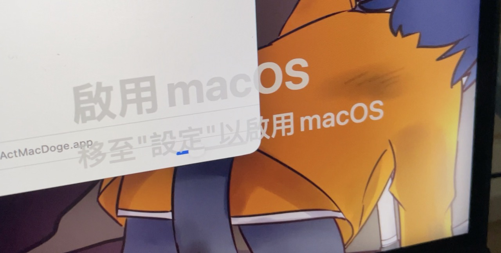

# ActMacDoge

給 macOS 加上一個 Windows 風格的「啟用」水印，順便做了個啟用視窗。只是玩梗，不能真的啟用 macOS：）



## 使用

開啟 `ActMacDoge.app`，從選單列的鑰匙圖示切換語言或退出。試試輸入 `114514`？

目前提供的 App 為 Apple Silicon + x86_64 版本，使用 ad-hoc 簽章。下載後如果被 macOS 阻擋，可在確認來源可信後執行：

```bash
xattr -cr /path/to/ActMacDoge.app
```

## 授權

本專案採用 [GNU GPL v2](LICENSE) 授權。

## 喵

由 [Kaimo](https://k.catkai.net) 和 Guanzi(AI) 一起製作。Kaimo提供創意和程式碼修正，罐子負責部分程式碼與這份說明檔：）

Kaimo & Guanzi
